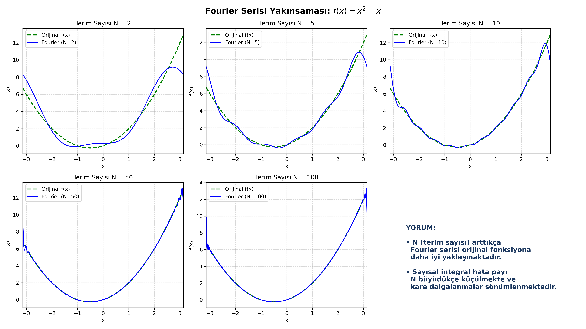

# Fourier Series Approximation & Numerical Integration

Numerical implementation and harmonic convergence analysis of the non-periodic function $f(x) = x^2 + x$ over $[-\pi, \pi]$ using adaptive quadrature integration (`scipy.integrate.quad`).

## Mathematical Formulation
* **Target Function:** $f(x) = x^2 + x$
* **Orthogonal Decomposition:**
  $$f(x) \approx \frac{a_0}{2} + \sum_{n=1}^{N} \left( a_n \cos(nx) + b_n \sin(nx) \right)$$
* **Convergence Evaluation:** Comparative harmonic synthesis across $N \in \{2, 5, 10, 50, 100\}$.

## Results & Output

## Technologies
* Python (NumPy, SciPy, Matplotlib)
* Numerical Integration & Harmonic Analysis
